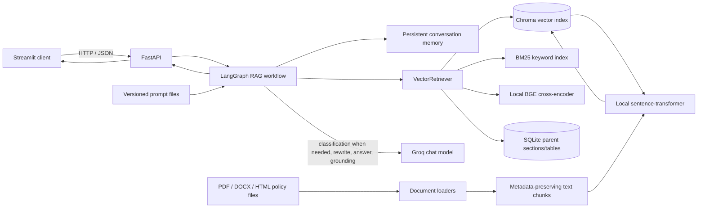
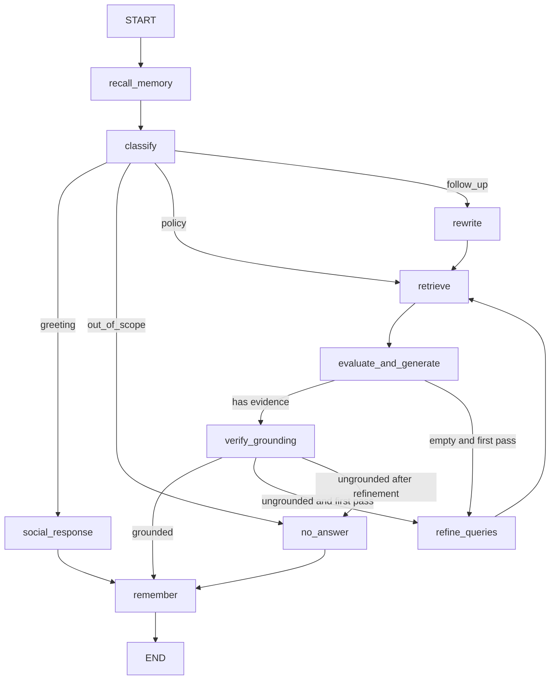

# Backend Architecture

This document describes the current Merchant Policy RAG Chatbot backend. The
backend is a FastAPI application with a LangGraph-orchestrated RAG workflow,
Groq answer generation, local sentence-transformer embeddings and reranking,
hybrid retrieval, and persistent Chroma and SQLite stores.

## 1. Architecture at a glance



Retrieval combines BM25 keyword search and Chroma vector search using
Reciprocal Rank Fusion, then reranks candidates with a local BGE cross-encoder.
Groq is used for language tasks only; embeddings and reranking run locally.

## 2. Components

| Component | Responsibility |
|---|---|
| [`server/api/main.py`](./server/api/main.py) | FastAPI startup, HTTP routes, request logging, and provider/error mapping. |
| [`server/models/schemas.py`](./server/models/schemas.py) | Pydantic request and response models. |
| [`server/config.py`](./server/config.py) | Environment-based settings and project-relative data paths. |
| [`server/services/rag.py`](./server/services/rag.py) | Builds and invokes the LangGraph workflow, formats evidence, and returns the chat result. |
| [`server/services/memory.py`](./server/services/memory.py) | SQLite-backed conversation history and retrieval of relevant earlier exchanges, keyed by conversation ID. |
| [`server/services/prompts.py`](./server/services/prompts.py) | Loads and renders named LangChain prompt templates from a versioned prompt directory. |
| [`server/prompts/v1/`](./server/prompts/v1/) | Versioned prompt templates for classification, retrieval, generation, and grounding. |
| [`server/retrieval/vector.py`](./server/retrieval/vector.py) | Metadata-filtered BM25 and Chroma search, RRF fusion, and local cross-encoder reranking. |
| [`server/retrieval/parent_store.py`](./server/retrieval/parent_store.py) | SQLite storage and lookup for parent sections and complete tables. |
| [`server/services/knowledge_base.py`](./server/services/knowledge_base.py) | Local embedding model, Chroma collection, parent storage, indexing, and indexed-document inspection. |
| [`server/ingestion/loaders.py`](./server/ingestion/loaders.py) | PDF, DOCX, and HTML text/table extraction and metadata. |
| [`server/ingestion/chunker.py`](./server/ingestion/chunker.py) | Splits extracted content into overlapping chunks. |
| [`server/ingestion/index_documents.py`](./server/ingestion/index_documents.py) | Command-line entry point for indexing or refreshing the policy directory. |

## 3. LangGraph workflow

Each `/chat` call invokes a compiled `StateGraph` with a fresh state. Durable
conversation memory lives in SQLite, keyed by conversation ID; a LangGraph
recall node loads recent messages and retrieves up to three relevant older
exchanges. Retrieval results and other per-turn data are not persisted in graph
state.

### State

The graph state contains the current question and conversation ID, bounded
history, query category, search query or refinement queries, retrieval pass
number, retrieved `(Document, similarity)` results, reranker score, evidence and
grounding decisions, final answer, and citations. No retrieved context or policy
facts are loaded from conversation history.

### Nodes and transitions

1. **`recall_memory`** loads recent history and retrieves older exchanges with
   overlapping terms from the same conversation. Recalled messages are context
   only, never evidence for policy claims.
2. **`classify`** answers common standalone pleasantries locally, routes clear
   policy questions without a model call, and recognizes explicit contextual
   follow-ups when history exists. Other messages are sent to Groq for
   classification as `policy`, `follow_up`, `greeting`, or `out_of_scope`. An
   invalid label is logged and treated as a policy question. A follow-up label
   with no recent history is treated as a policy question.
3. **`rewrite`** runs only for follow-ups. It converts the latest question into
   a standalone search query using recent messages to resolve references.
   Otherwise, the original question is searched.
4. **`retrieve`** infers supported metadata hints from the original question,
   runs broad BM25 and vector search, gives metadata matches a soft ranking
   boost, fuses the rankings with RRF, and reranks the candidate pool. It
   returns matching parent sections or complete tables. For refinement queries,
   it merges duplicate sources and keeps the highest reranker score.
5. **`evaluate_and_generate`** drafts an answer from the reranked excerpts.
   Empty retrieval skips generation and proceeds to refinement or fallback.
6. **`verify_grounding`** checks that factual claims are supported by excerpts
   and cited. Citation validation matches the document/page against retrieved
   sources and normalizes common Unicode citation brackets and whitespace. If
   verification fails on the first pass, the graph tries one query refinement;
   a second failure uses the fixed fallback. This replaces the separate
   LLM-based evidence-sufficiency gate, reducing one model call while retaining
   citation and grounding safeguards.
7. **`refine_queries`** runs at most once when retrieval is empty or grounding
   fails. Groq proposes up to two targeted searches, then the graph retrieves
   and verifies the revised evidence.
8. **`social_response`** handles classified greetings without policy context.
   Its restricted prompt allows social pleasantries but forbids factual answers.
9. **`no_answer`** returns the fixed no-answer message for out-of-scope requests,
   empty retrieval after refinement, or failed grounding after refinement.
10. **`remember`** appends the current user message and final response to SQLite
    once at the end of every graph path.



Common standalone pleasantries are answered locally without a provider call.
Clear policy questions bypass the classifier. There is no separate LLM
evidence-sufficiency gate; generated answers must still pass citation matching
and the grounding check. A failed grounding check gets at most one refinement
pass with no more than two additional search queries. If the model returns no
valid refinement query, retrieval yields no additional evidence and the
workflow reaches the fixed fallback. Groq/provider errors propagate to the API
error handler rather than being converted into a successful-looking answer.

The returned `reranker_score` is the highest raw cross-encoder score among
retrieved evidence for a grounded answer. It is a ranking score, not a
calibrated probability. Greeting responses and fallback answers have a score
of `0.0` and no citations. `RELEVANCE_THRESHOLD`, when set, filters results
against that raw score; calibrate it on representative questions before use.

## 4. Request lifecycle and API

Run the API from the project root in PowerShell:

```powershell
$env:PYTHONPATH = "server"
python -m uvicorn api.main:app --reload
```

At startup, the FastAPI lifespan handler creates the knowledge base, opens
Chroma, and validates the whole collection and its parent records. It indexes
the local policy documents if the collection is empty or incomplete, even when
it already contains chunks. It then constructs `RAGService` and its compiled
graph. `GROQ_API_KEY` must be configured for chat generation. Embeddings and
reranking run locally.

`POST /chat` validates the question, uses a supplied conversation ID or creates
a UUID, invokes the graph, and returns `answer`, `reranker_score`, `sources`, and
`conversation_id`. Existing conversation IDs select only that conversation's
recent messages for follow-up context. API failures are logged and mapped to
HTTP errors by `server/api/main.py`.

All routes except `GET /health` require the configured bearer token. This is a
shared-token gate for a private deployment, not per-user identity or
conversation ownership.

| Method and path | Purpose |
|---|---|
| `GET /health` | Basic API process health. |
| `POST /chat` | Run the LangGraph policy-answering workflow. |
| `GET /conversations/{conversation_id}` | Return messages retained for a conversation. |
| `DELETE /conversations/{conversation_id}` | Clear that conversation's retained history. |
| `GET /documents` | List indexed documents and chunk counts. |
| `GET /documents/{document_name}/chunks?offset=0&limit=20` | Inspect stored chunks for a document. |

The answer format is:

```json
{
  "answer": "The policy says ... [settlements.pdf, page 2]",
  "reranker_score": 0.82,
  "sources": [
    {
      "document": "settlements.pdf",
      "page": 2
    }
  ],
  "conversation_id": "conversation-uuid"
}
```

## 5. Conversation memory

`ConversationMemory` stores conversation exchanges in a SQLite database,
separate from Chroma and keyed by conversation ID. The graph recalls the latest
12 messages and up to three older exchanges whose terms overlap the current
question. All remembered messages are context for intent and follow-up
resolution only; policy answers must still be supported by retrieved policy
excerpts and pass citation and grounding checks.

The default retention is 200 exchanges per conversation and 256 active
conversations. `DELETE /conversations/{conversation_id}` removes saved history.
The default database is `server/data/memory.sqlite3` and persists across API
restarts. The local SQLite file is suitable for a single server instance; use a
shared database implementation for multi-replica deployments. Prompt templates
are loaded separately from the versioned `server/prompts/v1/` directory.

## 6. Ingestion and retrieval

Store original policy files in `server/data/documents/` by default. PDF, DOCX,
HTML, and HTM are supported. PDFs are directly parsed for text and tables;
OCR is not performed, so image-only PDF pages do not produce searchable text.
Extracted metadata includes document/source information, page where available,
section headings, content type, policy type, region, version, effective date,
and payment method. Region/version/date/payment tags are inferred conservatively
from source text; missing or ambiguous values are marked `unspecified`.

The indexer recursively loads supported files, creates parent sections and
whole-table records, then splits them into smaller searchable chunks. Each
chunk stores a parent ID, and complete parents are persisted in
`server/data/chroma/parents.sqlite3`. Chunks are embedded locally and written to
the Chroma collection `merchant_policy_rag`. At query time, BM25 and vector results are retrieved without inferred hard
filters; metadata matches provide a soft boost before RRF fusion and reranking
by a local BGE cross-encoder. A successful reindex reconciles the collection with
the current source directory. Run it after adding, changing, or removing policy
sources:

```powershell
$env:PYTHONPATH = "server"
python -m ingestion.index_documents
```

The source files are stored under `server/data/documents/`; persistent Chroma
data is stored under `server/data/chroma/` by default. Both locations can be
overridden by environment settings.

## 7. Configuration and secrets

Pydantic Settings reads a project-root `.env` file when present. Keep the Groq
key in that file or in the deployment secret manager; do not place it in the
Streamlit client or commit it.

| Environment variable | Default | Purpose |
|---|---|---|
| `GROQ_API_KEY` | Empty; required | Groq chat model credential. |
| `GROQ_MODEL` | `openai/gpt-oss-120b` | Chat model identifier available to the Groq account. |
| `PROMPT_VERSION` | `v1` | Versioned prompt directory loaded by the prompt manager. |
| `EMBEDDING_MODEL` | `sentence-transformers/all-MiniLM-L6-v2` | Local sentence-transformer model. |
| `CHROMA_PERSIST_DIRECTORY` | `<project>/server/data/chroma` | Persistent vector store location. |
| `DOCUMENT_DIRECTORY` | `<project>/server/data/documents` | Original policy documents. |
| `MEMORY_DATABASE_PATH` | `<project>/server/data/memory.sqlite3` | Persistent conversation memory database. |
| `CHUNK_SIZE` / `CHUNK_OVERLAP` | `900` / `150` | Chunk size and overlap in characters. |
| `RETRIEVAL_K` | `20` | Hybrid candidates passed to the reranker. |
| `RERANKER_TOP_K` | `5` | Parent sections/tables returned after reranking. |
| `RRF_CONSTANT` | `60` | Reciprocal Rank Fusion smoothing constant. |
| `RERANKER_MODEL` | `BAAI/bge-reranker-base` | Local Sentence Transformers cross-encoder. |
| `RERANKER_DEVICE` | `auto` | Reranker execution device: `auto`, `cpu`, or `cuda`. |
| `RELEVANCE_THRESHOLD` | Unset | Optional minimum raw reranker score; unset disables score filtering. |
| `API_AUTH_TOKEN` | Empty | Bearer token required for protected API routes. |
| `CORS_ORIGINS` | `http://localhost:8501` | Comma-separated allowed origins. |
| `POLICY_API_URL` | `http://localhost:8000` | Streamlit API base URL. |
| `POLICY_API_TOKEN` | Empty | Streamlit bearer token; must match `API_AUTH_TOKEN`. |

## 8. Running and validation

Install backend dependencies from the project root:

```powershell
python -m pip install -r server\requirements.txt
```

LangGraph is constrained to the 0.6 release line and LangChain Core to 0.3.x
because the current `langchain-groq` integration requires the pre-1.0 Core API.
Keep these constraints aligned when upgrading the LangChain packages.

Run the Streamlit client in a second terminal:

```powershell
$env:POLICY_API_URL = "http://localhost:8000"
$env:POLICY_API_TOKEN = "same-token-as-API_AUTH_TOKEN"
python -m streamlit run client\app.py
```

Docker Compose builds the server from `server/Dockerfile`, uses a named volume
for Chroma and a separate named volume for conversation memory, mounts source
documents read-only, and connects the client to the API on the Compose network.

Run tests from the project root:

```powershell
$env:PYTHONPATH = "server"
python -m pytest tests
```

The LangGraph tests cover grounded answers, bounded multi-query refinement,
grounding rejection, follow-up rewriting, and conversation isolation. Hybrid
retrieval tests cover metadata inference, fusion/reranking, and parent records.
If the server returns an unexpected fallback, check source extraction and
reindexing, metadata ranking hints, the configured reranker threshold, and the
evidence-check decisions in `server/services/rag.py`.
