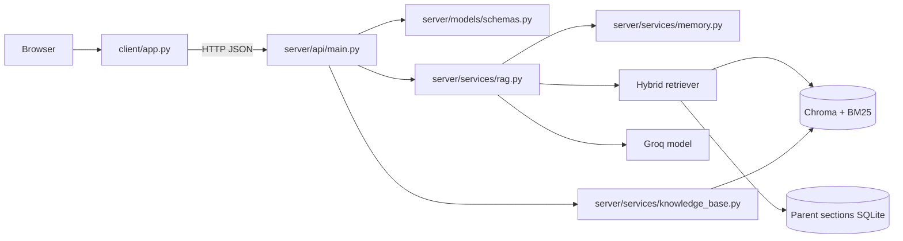

# Project Structure and Code Guide

This guide describes the files, folders, main functions, and connections in the
Merchant Policy RAG Chatbot. It reflects the project layout inspected on
2026-10-29. Generated files, Python caches, virtual environments, and the
contents of Chroma databases are not enumerated because they can change while
the application runs.

## 1. Project map

```text
policy_chatbot/
├── client/
│   ├── app.py
│   ├── requirements.txt
│   ├── Dockerfile
│   └── .dockerignore
├── server/
│   ├── api/
│   │   └── main.py
│   ├── ingestion/
│   │   ├── loaders.py
│   │   ├── chunker.py
│   │   └── index_documents.py
│   ├── models/
│   │   └── schemas.py
│   ├── retrieval/
│   │   ├── parent_store.py
│   │   └── vector.py
│   ├── services/
│   │   ├── knowledge_base.py
│   │   ├── memory.py
│   │   ├── prompts.py
│   │   └── rag.py
│   ├── prompts/
│   │   └── v1/
│   │       ├── answer.txt
│   │       ├── classifier.txt
│   │       ├── follow_up_rewrite.txt
│   │       ├── grounding.txt
│   │       ├── query_refinement.txt
│   │       └── social_response.txt
│   ├── data/
│   │   ├── documents/
│   │   ├── chroma/ (generated vector data)
│   │   └── memory.sqlite3 (created at runtime)
│   ├── config.py
│   ├── logging_config.py
│   ├── requirements.txt
│   ├── Dockerfile
│   ├── .dockerignore
├── tests/
│   ├── test_api_auth.py
│   ├── test_hybrid_retrieval.py
│   └── test_rag_graph.py
├── .env.example
├── .gitignore
├── docker-compose.yml
├── README.md
├── BACKEND_ARCHITECTURE.md
└── PROJECT_STRUCTURE.md
```

The tree above shows the application source and important project files. The
repository also contains Python package marker files (`__init__.py`) in
`server/`, `server/api/`, `server/ingestion/`, `server/models/`, and
`server/services/`. They mark those directories as Python packages; they
currently contain no application functions.

## 2. What happens when a question is asked



1. Streamlit restores the selected conversation and displays its messages.
2. When a user submits a question, Streamlit posts the question and
   `conversation_id` to FastAPI's `/chat` route.
3. FastAPI validates the request and calls `RAGService.answer()`.
4. The LangGraph workflow recalls recent and relevant older messages from
   SQLite, then classifies the message. A follow-up is rewritten using that
   conversation context. A policy question gets broad BM25 and Chroma
   retrieval, with metadata hints used as a soft ranking boost before
   cross-encoder reranking.
5. If the first search is insufficient, the graph can run one refinement pass
   with up to two additional queries. A direct evidence check and grounding
   check gate policy answers.
6. The graph stores the exchange in bounded SQLite memory and returns the
   answer, reranker score, cited sources, and conversation ID.
7. Streamlit renders the answer and its citation/reranker-score details.

## 3. Root-level files

| File | Purpose |
|---|---|
| [`README.md`](./README.md) | Quick-start instructions, environment setup, data indexing, local run, Docker, and API basics. |
| [`BACKEND_ARCHITECTURE.md`](./BACKEND_ARCHITECTURE.md) | Detailed backend workflow and design, especially the LangGraph steps, API, memory, and retrieval. |
| [`PROJECT_STRUCTURE.md`](./PROJECT_STRUCTURE.md) | This file: folder and file map, function guide, and connections. |
| [`docker-compose.yml`](./docker-compose.yml) | Starts the FastAPI server and Streamlit client; configures networking, ports, persistent Chroma and memory volumes, and the source-document mount. |
| [`.env.example`](./.env.example) | Safe configuration template containing Groq, API-token, model, storage, chunking, retrieval, and CORS settings. Copy it to `.env` and replace secret placeholders. |
| [`.gitignore`](./.gitignore) | Keeps local secrets, Python environments/caches, Chroma output, and local policy documents out of source control. |

## 4. `client/` — Streamlit user interface

The client is a separate process from the API. It calls the server over HTTP;
it does not import backend Python services.

### `client/app.py`

Creates the chat screen, requests server endpoints, restores conversation
history, and displays assistant answers and citations.

Main functions:

- `_request_error(exc)` — Returns the API's JSON `detail` when present, otherwise
  the HTTP client's error text.
- `_render_message(message, message_index)` — Renders one user or assistant
  message. Assistant messages use Markdown; user messages use plain text.
  Displays cited sources and the reranker score when included.

Other top-level behavior:

- Reads `POLICY_API_URL` and `POLICY_API_TOKEN`.
- Configures Streamlit and injects the page styling, navbar, and hero section.
- Initializes `st.session_state` values for messages, conversation ID, and
  history loading.
- Calls `GET /conversations/{conversation_id}` to restore the session.
- Uses `st.chat_input` and `POST /chat` to submit a question and append its
  answer to the displayed transcript.
- Displays request failures in the chat instead of hiding them.

### Other client files

- `client/requirements.txt` — Python dependencies for Streamlit and HTTP
  requests.
- `client/Dockerfile` — Builds the Streamlit image and starts it on port 8501.
- `client/.dockerignore` — Prevents local environment files, virtual
  environments, and Python caches from entering the client build context.

## 5. `server/` — FastAPI backend

The backend owns settings, ingestion, the vector database connection, API
validation, retrieval, chat orchestration, and conversation memory.

### `server/api/`

#### `server/api/main.py`

Defines the FastAPI application, initializes services at startup, and implements
HTTP endpoints.

- `lifespan(app)` — Creates `KnowledgeBase`, indexes documents if Chroma is
  empty, then attaches the knowledge base and `RAGService` to `app.state`.
- `log_requests(request, call_next)` — Logs request method, URL path, status,
  and elapsed time after a request completes.
- `health()` — Implements `GET /health`.
- `chat(body, request)` — Implements `POST /chat`; creates or accepts the
  conversation ID, calls the RAG service, returns the validated response, and
  converts Groq/network/processing errors into HTTP errors.
- `conversation_history(conversation_id, request)` — Implements
  `GET /conversations/{conversation_id}`.
- `clear_conversation(conversation_id, request)` — Implements
  `DELETE /conversations/{conversation_id}`.
- `documents(request)` — Implements `GET /documents`.
- `document_chunks(document_name, request, offset, limit)` — Implements
  `GET /documents/{document_name}/chunks`; validates pagination and returns
  stored chunks or a not-found response.

The module's `app` object is the ASGI application used by Uvicorn:
`uvicorn api.main:app`.

### `server/models/`

#### `server/models/schemas.py`

Defines Pydantic API data models. These models validate HTTP input and shape
responses; they do not perform retrieval or generate answers.

- `SourceReference` — Source document name and optional page number.
- `ChatRequest` — User question plus optional conversation ID, with length
  validation.
- `ChatResponse` — Answer, raw reranker score, cited source list, and
  conversation ID.
- `ConversationMessage` — A `user` or `assistant` role and its message content.
- `ConversationHistory` — Conversation ID and messages returned by the history
  endpoint.
- `DocumentInfo` — Indexed document name, path/source, chunk count, and
  categories.
- `HealthResponse` — Status and service name returned by `/health`.

### `server/services/`

#### `server/services/rag.py`

The main RAG orchestration service. It constructs a LangGraph `StateGraph`,
invokes its nodes for each question, formats retrieved evidence, and updates
conversation memory. Versioned prompts in `server/prompts/v1/` instruct Groq how
to classify, rewrite, refine, answer, and verify grounding.

Types:

- `SourceReference` — Typed source dictionary with document and optional page.
- `RAGState` — Typed graph state: question, history, queries, retrieved
  documents, reranker score, decisions, answer, and cited sources.
- `RAGResult` — Typed service result consumed by the API.

`RAGService` methods:

- `__init__(settings, retriever)` — Validates the Groq key, configures the model,
  creates persistent conversation memory and the
  prompt manager, and compiles the graph.
- `_build_graph()` — Registers graph nodes and edges, including conditional
  routing for memory recall, message type, and grounding.
- `answer(question, conversation_id)` — Initializes a clean per-turn state,
  invokes the asynchronous graph, and returns its public result.
- `_recall_memory(state)` — Loads recent and query-relevant conversation
  exchanges for context resolution.
- `_evaluate_and_generate(state)` — Drafts an answer from retrieved evidence;
  only a cited and grounded answer can be returned.
- `_classify(state)` — Handles common pleasantries and obvious policy questions
  locally, recognizes explicit contextual follow-ups, and asks the model to
  classify less clear messages.
- `_route_classification(state)` — Sends the classified state to greeting,
  fallback, retrieval, or follow-up rewriting.
- `_rewrite_query(state)` — Converts a contextual follow-up into a standalone
  retrieval query without treating history as policy evidence.
- `_retrieve(state)` — Infers metadata hints, runs broad hybrid search for active
  queries, merges duplicate parent sources, and records reranker scores.
- `_route_generation(state)` — Chooses grounding verification, one retrieval
  refinement, or the no-answer path.
- `_refine_queries(state)` — Creates up to two additional targeted queries for
  empty retrieval or failed grounding and increments the bounded retrieval-pass
  counter.
- `_generate_answer(state)` — Drafts a response from retrieved excerpts and
  builds the distinct source/page list from citations in the answer.
- `_verify_grounding(state)` — Rejects answers whose citations do not match
  retrieved sources, then asks the model to verify evidence support.
- `_citations_match_sources(answer, sources)` — Normalizes common full-width
  citation brackets and whitespace, then checks each citation against the
  retrieved document/page list.
- `_route_grounding(state)` — Sends grounded responses to memory; gives an
  ungrounded first-pass answer one retrieval refinement before fallback.
- `_set_no_answer(state)` — Sets the fixed safe no-answer message and clears
  the reranker score and citations.
- `_social_response(state)` — Handles greetings without supplying policy
  excerpts or factual model knowledge.
- `_remember(state)` — Stores the exchange once after the selected graph path.
- `get_history(conversation_id)` — Returns retained history for that session.
- `clear_history(conversation_id)` — Removes one session's retained history.
- `_format_history(history)` — Formats recent messages for model prompts.
- `_format_context(results)` — Formats retrieved documents with citations for
  model prompts.
- `_content(response)` — Extracts text from a model response object.

Module function:

- `new_conversation_id()` — Returns a new UUID string for a conversation.

#### `server/services/memory.py`

Implements bounded, thread-safe SQLite-backed episodic conversation memory.

- `ConversationMemory.__init__(database_path, ...)` — Initializes the database
  and validates retention limits.
- `get(conversation_id)` — Returns the latest messages for one conversation.
- `recall(conversation_id, query)` — Retrieves older exchanges relevant to the
  current message, scoped to that same conversation.
- `add_exchange(conversation_id, question, answer)` — Persists the exchange and
  enforces conversation and exchange retention limits.
- `clear(conversation_id)` — Deletes one conversation from memory.

The default keeps the latest 12 messages in immediate history and up to 200
exchanges per conversation. SQLite memory persists across server restarts. Use a
shared database implementation for multi-replica deployments.

#### `server/services/prompts.py`

`PromptManager` loads and renders named LangChain prompt templates from the
versioned `server/prompts/v1/` directory. Missing prompt files and required
template variables are reported explicitly.

#### `server/services/knowledge_base.py`

Connects document ingestion, local embeddings, and persistent Chroma storage.
Also exposes inspection data used by the document API routes.

- `KnowledgeBase.__init__(settings)` — Creates configured directories, loads
  the local Hugging Face embedding model, opens the Chroma collection, and
  creates a hybrid `VectorRetriever` and SQLite parent store.
- `chunk_count` — Property returning the indexed chunk count.
- `ensure_index_current()` — Reuses a complete collection or indexes configured
  documents when chunks or parent references are missing or stale.
- `index_directory()` — Loads supported files recursively, creates parent
  sections/tables and child chunks, sanitizes metadata, calculates stable IDs,
  writes current chunks and parent records, and deletes obsolete IDs.
- `document_list()` — Groups stored metadata into per-document counts and
  categories.
- `document_chunks(name, offset, limit)` — Returns sorted stored chunks for one
  document with pagination.
- `_sanitize_metadata(document)` — Removes `None` metadata values before
  storage.

### `server/ingestion/`

This folder prepares source policy files for indexing. It does not expose a
public upload endpoint; documents are managed in the configured local folder
and indexed by command or on empty-database startup.

#### `server/ingestion/loaders.py`

- `SUPPORTED_EXTENSIONS` — The supported input extensions: PDF, DOCX, HTML, and
  HTM.
- `ExtractedPage` — Internal dataclass holding extracted text, optional page
  number, tables, and headings.
- `_clean_table(rows)` — Normalizes table cells and converts rows to readable
  pipe-separated text.
- `load_file(path, document_name)` — Extracts text and tables from a PDF, DOCX,
  or HTML file and returns LangChain `Document` objects with metadata. PDF
  parsing is direct text/table extraction; OCR is not used.
- `_infer_category(name, text)` — Infers a broad policy category using terms in
  the document name and initial text.

#### `server/ingestion/chunker.py`

- `split_parent_documents(documents, parent_size)` — Creates parent sections
  and preserves complete tables.
- `split_documents(documents, chunk_size, chunk_overlap)` — Splits documents
  into overlapping child chunks, preserves parent IDs, adds start indices, and
  assigns stable chunk identifiers.

#### `server/ingestion/index_documents.py`

- `main()` — Loads settings, configures logging, creates a `KnowledgeBase`,
  indexes the documents folder, and reports the number of chunks.
- The `if __name__ == "__main__"` block — Runs `main()` and logs/re-raises
  indexing errors. Invoked from the project root as
  `python -m ingestion.index_documents` with `PYTHONPATH=server`.

### `server/retrieval/`

#### `server/retrieval/vector.py`

- `infer_metadata_hints(query)` — Detects region, policy type, payment method,
  version, and effective-date hints from a query.
- `VectorRetriever.search(query, metadata_hints)` — Retrieves broad candidates
  with BM25 and Chroma, gives metadata matches a soft boost, fuses ranks with
  RRF, applies cross-encoder reranking and an optional score threshold, then
  returns matching parent documents.
- `VectorRetriever._get_reranker()` — Lazily loads the configured local
  Sentence Transformers cross-encoder.

#### `server/retrieval/parent_store.py`

- `ParentDocumentStore.replace(documents)` — Persists the current parent
  sections and tables in SQLite.
- `ParentDocumentStore.get_many(parent_ids)` — Loads parent content for ranked
  child chunks.

### Other backend files

- `server/config.py`
  - `Settings` — Declares environment-backed settings, defaults, paths,
    `API_AUTH_TOKEN`, and the optional `RELEVANCE_THRESHOLD`.
  - `Settings.resolve_data_path(value)` — Resolves relative document, Chroma,
    and conversation memory paths from the project root.
  - `Settings.allowed_origins` — Returns parsed CORS origins.
  - `get_settings()` — Returns the cached settings instance.
- `server/logging_config.py`
  - `JsonFormatter.format(record)` — Formats a log record and its extra
    structured fields as JSON.
  - `configure_logging(level)` — Configures the root logger to write JSON logs
    to standard output.
- `server/requirements.txt` — Backend dependencies, including FastAPI, Groq
  integration, LangGraph, Chroma, document parsers, and local embedding
  packages. LangGraph and LangChain Core version ranges are aligned with the
  current Groq integration.
- `server/Dockerfile` — Builds the API image, installs backend dependencies,
  creates data paths, and starts Uvicorn as a non-root user.
- `server/.dockerignore` — Excludes local environment files, Python
  environments, and caches from the backend Docker build context.
- `server/.env` — A local environment file was present when this guide was
  prepared. It is ignored by Git; keep credentials private and do not copy keys
  into documentation or source code.

## 6. `server/data/` — policy sources and vector database

These are runtime data folders, not Python modules.

- `server/data/documents/` — Original source policies. At the time this guide
  was prepared, it contained:
  - `customer_dispute_resolution_mechanism.pdf`
  - `fraud_monitoring_and_prevention_policy.pdf`
  - `merchant_offboarding_policy.pdf`
  - `merchant_onboarding_terms_and_conditions.pdf`
  - `risk_management_policy.pdf`
  - `.gitkeep`, which preserves the otherwise-empty folder in source control.
- `server/data/chroma/` — Active persistent Chroma database. `config.py`
  defaults to this directory; `docker-compose.yml` mounts a persistent Docker
  volume here in the container. It contains generated index data and should not
  be edited by hand.
- `server/data/memory.sqlite3` — Created at runtime for persistent conversation
  exchanges; ignored by Git. Configure `MEMORY_DATABASE_PATH` to change it.


Other workspace folders such as `.pytest_cache/`, `server/.pytest_cache/`,
`server/.venv/`, and `__pycache__/` directories are generated by test runs,
local Python execution, or package installation. They are not application
source and should not be edited as part of normal feature work.

## 7. `tests/` — automated checks

### `tests/test_rag_graph.py` and `tests/test_api_auth.py`

Uses fake model and retriever objects so workflow paths can be tested without
Groq network calls or a live Chroma database. The RAG tests use temporary
SQLite paths rather than the persistent local memory database.

- `FakeModel` — Returns deterministic classifier, rewrite, answer, and
  grounding responses based on the prompt.
- `FakeModel.ainvoke(messages)` — Mimics the asynchronous chat model interface.
- `FakeRetriever` — Records query strings and returns controlled documents and
  scores.
- `FakeRetriever.search(query)` — Mimics vector retrieval.
- `FakeRetriever._document(text)` — Builds a test document with source/page
  metadata.
- `make_service(retriever, grounded, answer)` — Creates a `RAGService` with
  test dependencies.
- `test_graph_generates_cited_answer_from_sufficient_evidence()` — Ensures
  sufficient retrieved evidence yields a cited answer and remembers it.
- `test_graph_refines_once_and_keeps_evidence_from_both_search_passes()` —
  Covers the bounded refinement path and union of retrieved evidence.
- `test_unsupported_answer_is_replaced_with_fixed_no_answer()` — Verifies that
  failed model grounding checks produce the safe fallback.
- `test_answer_with_citation_not_in_retrieved_sources_is_rejected()` — Verifies
  fabricated document/page citations are rejected.
- `test_answer_with_unicode_citation_format_is_accepted()` — Covers normalized
  full-width citation brackets and narrow whitespace.
- `test_sources_only_include_passages_cited_in_the_answer()` — Ensures
  uncited retrieved passages are omitted from the response source list.
- `test_follow_up_rewrite_uses_only_its_conversation_history()` — Checks
  follow-up rewrite and isolation between conversation IDs.
- `test_out_of_scope_message_uses_safe_fallback_without_retrieval()` — Ensures
  out-of-scope content does not trigger policy retrieval or unsupported
  generation.
- `test_empty_retrieval_uses_only_one_refinement_pass()` — Checks the no-result
  fallback after one refinement attempt.
- `test_greeting_path_does_not_search_policy_documents()` — Ensures greeting
  handling avoids policy retrieval.

Run from the project root in PowerShell:

```powershell
$env:PYTHONPATH = "server"
python -m pytest tests
```

`tests/test_api_auth.py` covers missing, invalid, and valid bearer tokens. The
hybrid retrieval tests cover stale-index repair, soft metadata ranking, missing
metadata, and optional reranker-score thresholds.

## 8. Relationships between the major files

### Indexing flow

```text
ingestion/index_documents.py
    → config.py: get_settings()
    → services/knowledge_base.py: KnowledgeBase.index_directory()
        → ingestion/loaders.py: load_file()
        → ingestion/chunker.py: split_documents()
        → local Hugging Face embeddings + Chroma
```

The same `KnowledgeBase` is also initialized by the FastAPI lifespan handler.
On every API startup it validates the collection and rebuilds it if chunk
metadata or parent references are incomplete; manual reindexing uses the
command above.

### Chat flow

```text
client/app.py
    → server/api/main.py
        → server/models/schemas.py
        → server/services/rag.py: RAGService.answer()
            → server/services/memory.py
            → server/retrieval/vector.py
                → Chroma collection created in services/knowledge_base.py
            → Groq via langchain-groq
```

### Configuration and deployment flow

```text
.env.example → developer's private .env → server/config.py
docker-compose.yml → server/Dockerfile + client/Dockerfile
                 → persistent Chroma volume + documents mount
                 → POLICY_API_URL and POLICY_API_TOKEN configure Streamlit access
```

## 9. Where to make common changes

| If you want to... | Start here |
|---|---|
| Change the chat UI, colors, layout, or message display | `client/app.py` |
| Change the `/chat` request/response shape | `server/models/schemas.py`, then `server/api/main.py` |
| Change graph steps, prompts, answer grounding, or retrieval refinement | `server/services/rag.py` |
| Change conversation retention limits | `server/services/memory.py` |
| Change supported file types or extraction/metadata | `server/ingestion/loaders.py` |
| Change chunk splitting behavior | `server/ingestion/chunker.py` and `server/config.py` |
| Change embedding model, Chroma setup, or indexing behavior | `server/services/knowledge_base.py` and `server/config.py` |
| Change vector top-k retrieval or score conversion | `server/retrieval/vector.py` and `server/config.py` |
| Change environment defaults or storage paths | `server/config.py` and `.env.example` |
| Change API/client container setup | `docker-compose.yml` and the respective Dockerfile |
| Add workflow regression coverage | `tests/test_rag_graph.py` |
